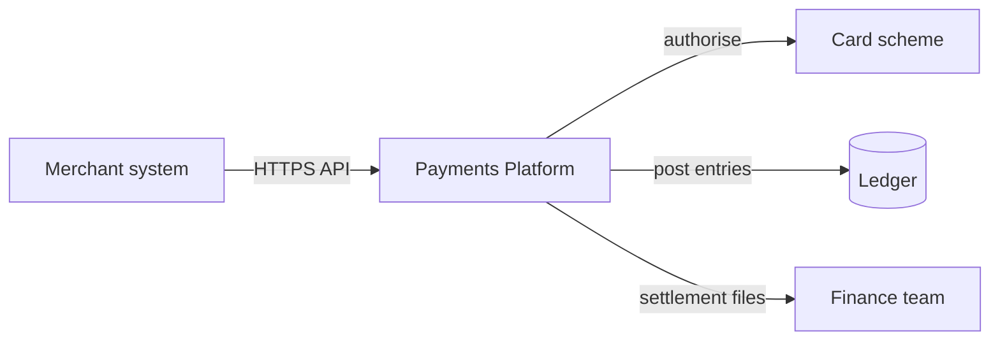
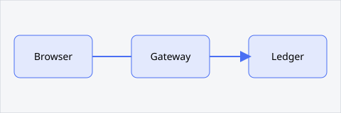

# Payments Platform Architecture

This is a sample arc42-style document for trying out the review tool. It has numbered sections, subsections, tables,
code, an image, and diagrams in both Mermaid and D2. Select any text to give feedback; hover a diagram for its
toolbar (show source, expand, add feedback on the whole diagram).

## 1. Introduction and Goals

The Payments Platform lets merchants take card payments and reconcile them against their ledger. It replaces three
legacy batch systems with one event-driven service.

### 1.1 Requirements Overview

| Id | Requirement | Priority |
|----|-------------|----------|
| R1 | Authorise a card payment in under 300 ms (p95) | Must |
| R2 | Never lose or duplicate a payment, even during failover | Must |
| R3 | Provide an auditable trail for every state change | Must |
| R4 | Support a second payment scheme within one quarter | Should |

### 1.2 Quality Goals

1. **Reliability**: no lost or duplicated payments.
2. **Performance**: fast authorisation at peak load.
3. **Auditability**: every decision can be explained afterwards.

### 1.3 Stakeholders

- Merchants who integrate through the public API
- The finance team who reconcile settlements
- The operations team who run the platform out of hours

## 2. Architecture Constraints

- The platform must run on the company's existing Kubernetes clusters.
- Card data may only be handled inside the PCI-scoped network segment.
- All services are written in TypeScript or Java; no new languages without an architecture decision record.

## 3. Context and Scope

### 3.1 Business Context

Merchants call the platform over HTTPS. The platform talks to the card scheme for authorisation and to the ledger for
bookkeeping. Finance reads settlement files produced by the platform.



### 3.2 Technical Context

The deployment is shown below.



Traffic enters through the gateway, which authenticates the merchant and applies rate limits before forwarding the
request to the payment service.

## 4. Solution Strategy

| Goal | Approach |
|------|----------|
| Reliability | Event sourcing with an outbox; idempotency keys on every command |
| Performance | Keep the authorisation path synchronous and minimal; everything else is asynchronous |
| Auditability | The event log is the system of record; read models are rebuilt from it |

## 5. Building Block View

### 5.1 Level 1

The platform is made of four building blocks. The gateway is stateless; the payment service owns the event log.

```d2
direction: right
gateway: Gateway
payments: Payment Service {
  commands: Command handler
  log: Event log
  commands -> log: append
}
ledger: Ledger adapter
reports: Settlement reports

gateway -> payments.commands: command
payments.log -> ledger: events
payments.log -> reports: events
```

### 5.2 Responsibilities

- **Gateway**: authentication, rate limiting, request validation.
- **Payment service**: state machine for each payment; the only writer of the event log.
- **Ledger adapter**: translates payment events into ledger entries, exactly once.
- **Settlement reports**: builds the daily files for finance.

## 6. Runtime View

### 6.1 Authorising a Payment

```d2
shape: sequence_diagram
merchant: Merchant
gateway: Gateway
payments: Payment Service
scheme: Card scheme

merchant -> gateway: POST /payments
gateway -> payments: authorise(command)
payments -> scheme: authorise
scheme -> payments: approved
payments -> gateway: 201 Created
gateway -> merchant: payment id
```

### 6.2 Idempotent Retries

A client that repeats a request with the same idempotency key receives the original response:

```ts
export async function authorise(cmd: Authorise): Promise<Payment> {
  const existing = await store.findByKey(cmd.idempotencyKey);
  if (existing) return existing; // safe to retry
  return store.append(new PaymentAuthorised(cmd));
}
```

## 7. Deployment View

The platform runs as three deployments in the PCI-scoped namespace. The event log is a managed PostgreSQL cluster with
synchronous replication to a second zone.

## 8. Crosscutting Concepts

### 8.1 Security

Card numbers are tokenised at the edge and never stored. Tokens are scoped per merchant.

### 8.2 Observability

Every command carries a correlation id that appears in logs, traces and the event log.

## 9. Architecture Decisions

| ADR | Decision | Status |
|-----|----------|--------|
| 001 | Use event sourcing for payment state | Accepted |
| 002 | Outbox pattern instead of distributed transactions | Accepted |
| 003 | Single-region active/passive for the first release | Proposed |

## 10. Quality Requirements

> Quality scenario: when the primary database zone fails during peak load, no payment is lost and authorisation
> latency returns to normal within two minutes.

## 11. Risks and Technical Debt

- The ledger adapter is a single point of failure until ADR 003 is decided.
- Settlement reports are rebuilt nightly; large merchants may exceed the window.

## 12. Glossary

| Term | Meaning |
|------|---------|
| Outbox | A table of events written in the same transaction as the state change, then published reliably |
| Idempotency key | A client-supplied value that makes a repeated request safe |
