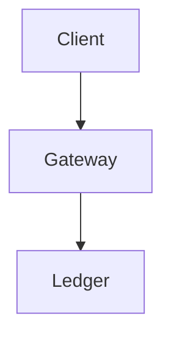

# Diagram Document

## 1. Context

Intro paragraph before the diagrams.



Text between the diagrams.

```d2
client -> gateway: request
gateway -> ledger: persist
```

Closing paragraph of section one.

## 2. Second Section

Opening paragraph of section two.

```d2
user -> app: clicks
app -> db: query
```

Final paragraph.
